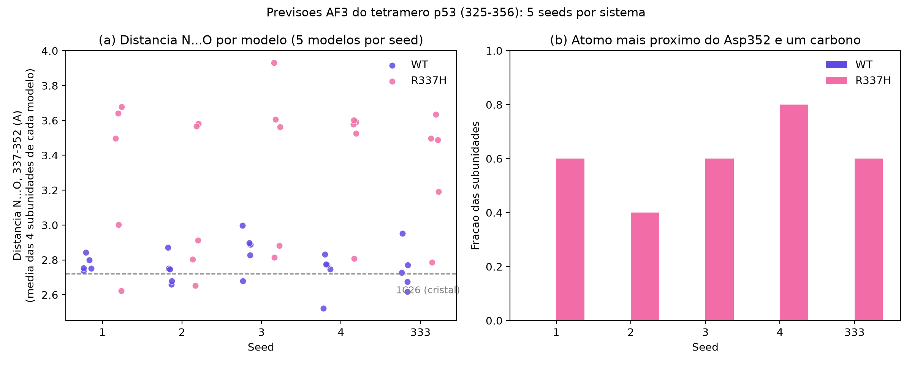

# R337H-TP53-AlphaFold3

Análise estrutural exploratória da variante **p.Arg337His (R337H)** do domínio de tetramerização da p53 (resíduos 325–356), usando previsões do AlphaFold 3 (AlphaFold Server) e comparação com a estrutura experimental [PDB 1C26](https://www.rcsb.org/structure/1C26).

> **Aviso sobre os dados do AlphaFold 3.** As tabelas em `results/tables/` e as figuras em `results/figures/` são derivadas de previsões do AlphaFold 3 e estão sujeitas aos [AlphaFold 3 Output Terms of Use](https://github.com/google-deepmind/alphafold3/blob/main/OUTPUT_TERMS_OF_USE.md) (uso **não comercial**). Elas foram **adaptadas** por este projeto (alinhamento, cálculo de distâncias e contatos, gráficos, figuras no ChimeraX). Ver `results/LEGALLY_BINDING_TERMS_OF_USE.txt`.
> Citação obrigatória: Abramson, J. et al. *Accurate structure prediction of biomolecular interactions with AlphaFold 3.* Nature (2024). https://doi.org/10.1038/s41586-024-07487-w
> Este projeto não é afiliado nem endossado pelo Google, Google DeepMind ou Isomorphic Labs.

> **Uso exclusivamente teórico.** Nada aqui é validado para uso clínico nem deve embasar decisões de saúde.

## Pergunta

Até que ponto o AlphaFold 3 reproduz a arquitetura tetramérica conhecida do domínio de tetramerização da p53 e identifica diferenças estruturais localizadas associadas à R337H?

## Desenho

- Sequência: UniProt P04637, resíduos 325–356 (numeração dos arquivos do AF3: 1–32; **Arg/His337 = resíduo 13, Asp352 = resíduo 28**).
- Dois sistemas: WT e R337H, 4 cópias cada, no AlphaFold Server.
- **5 seeds por sistema** (333, 1, 2, 3, 4), 5 modelos por seed: 25 modelos por sistema.
- Referência: montagem biológica do PDB 1C26.
- Critérios de contato definidos antes da análise: 5 Å (principal) e 4 Å (sensibilidade), entre átomos pesados.

## Resultados principais

| Tema | Resultado |
|---|---|
| Arquitetura global | RMSD de Cα (128 átomos, melhor pareamento de cadeias): WT vs 1C26 mediana 1,26 Å; R337H vs 1C26 1,16 Å. WT vs R337H 0,95 Å, próximo da variação interna de cada sistema (0,70–0,85 Å). |
| Contatos entre cadeias | Totais semelhantes (mediana a 5 Å: 1C26 206, WT 209, R337H 208). Oito contatos do resíduo 337 com 345/349 (interfaces A-C e B-D) estão em todos os 25 modelos WT e em nenhum R337H; nenhum contato é exclusivo do R337H. |
| Distância 337–352 (N···O) | WT: 2,52–3,00 Å em todos os 25 modelos (cristal: 2,72 Å). R337H: 2,62–3,93 Å; 16 de 25 modelos acima de 3,1 Å, presentes nas 5 seeds. |
| Átomo mais próximo do Asp352 | WT: sempre um N da guanidina. R337H: em 60 de 100 subunidades é o **CE1** (carbono do anel), em 40 é o NE2. |
| Confiança do AF3 | ipTM 0,82–0,85 (WT) e 0,86–0,89 (R337H). É confiança do modelo, **não** estabilidade. |



Relatório completo, com métodos, limitações e desvios do plano: [`report/final_report.md`](report/final_report.md).

## O que este projeto NÃO mostra

- Não mede estabilidade termodinâmica, afinidade de associação nem dependência de pH.
- O AF3 não informa o estado de protonação da histidina; os dois arranjos do anel (NE2 ou CE1 perto do Asp352) podem ser orientações do anel, não estados químicos distintos.
- Os 5 modelos de uma seed e as 4 subunidades de um modelo não são réplicas independentes.
- Domínio isolado, tetrâmero homogêneo (4×WT ou 4×R337H); heterozigotos não foram modelados.
- O 1C26 é anterior ao treinamento do AF3 e o servidor usa templates estruturais por padrão (`useStructureTemplate: true`); a comparação com o 1C26 é de consistência, não um teste cego.

## Estrutura

```text
data/sequences/      FASTAs WT e R337H (gerados por scripts/validate_sequences.py)
data/reference/      PDB 1C26 (montagem biológica e unidade assimétrica)
data/predictions/    saídas do AlphaFold Server (NÃO versionadas; ver abaixo)
scripts/             pipeline em Python
results/tables/      tabelas derivadas
results/figures/     figuras
report/              relatório final
docs/af3_jobs.md     registro dos jobs enviados ao servidor
```

## Como reproduzir

1. Python 3.12, `python -m venv .venv`, ativar, `pip install -r requirements.txt`.
2. `python scripts/validate_sequences.py` (gera os FASTAs).
3. No [AlphaFold Server](https://alphafoldserver.com/), submeter para cada sistema uma entidade *Protein* com **4 cópias** e as seeds 333, 1, 2, 3 e 4 (um job por seed), conforme `docs/af3_jobs.md`. Extrair cada zip em `data/predictions/{WT,R337H}/seed_<N>/`.
4. `python scripts/check_seeds.py` (confere que a seed da pasta bate com `modelSeeds`; **não prossiga se houver ERRO**).
5. `python scripts/download_reference.py`
6. `python scripts/qc_structures.py`
7. `python scripts/compare_structures.py` (demora alguns minutos)
8. `python scripts/interface_analysis.py`
9. `python scripts/analyze_by_seed.py`
10. `python scripts/closest_atoms.py`
11. `python scripts/generate_figures.py`

As figuras de zoom (`zoom_*.png`) foram feitas à mão no UCSF ChimeraX a partir de três modelos da seed 2 e são ilustrativas; ver legenda no relatório.

## Sobre os dados do AF3 não versionados

Os arquivos `.cif` e `.json` do AlphaFold Server ficam fora do Git (`data/predictions/` no `.gitignore`). Quem quiser reproduzir deve gerar as previsões no servidor, sujeito aos termos de uso dele.

## Licença

- **Código** (`scripts/`): MIT (ver `LICENSE`).
- **Tudo derivado de saídas do AlphaFold 3** (`results/`, incluindo tabelas e figuras): sujeito aos AlphaFold 3 Output Terms of Use, uso não comercial. A licença MIT **não** se aplica a esses arquivos.
- Estrutura 1C26: dados públicos do wwPDB.

## Referências

1. Abramson et al. (2024), *Nature*. https://doi.org/10.1038/s41586-024-07487-w
2. DiGiammarino et al. (2002), *Nat. Struct. Biol.* https://doi.org/10.1038/nsb730
3. PDB 1C26: https://www.rcsb.org/structure/1C26
4. UniProt P04637: https://www.uniprot.org/uniprotkb/P04637/entry
