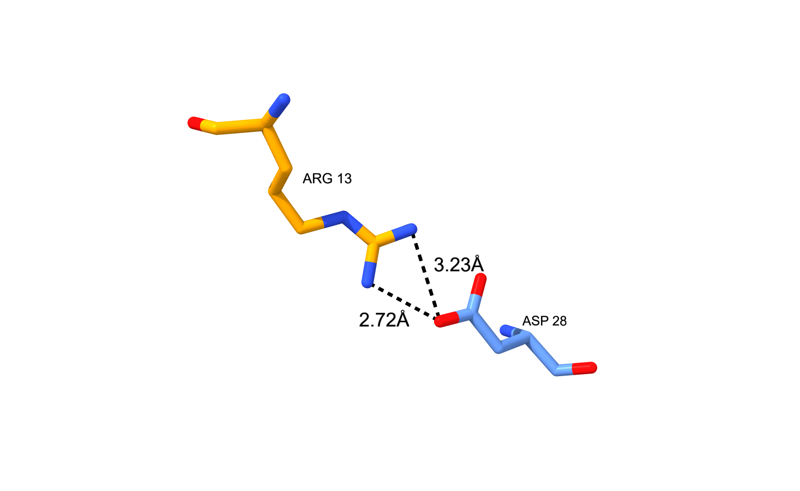
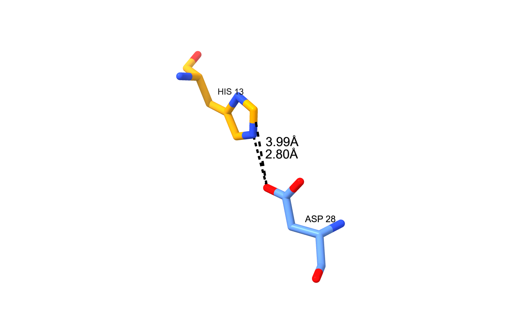
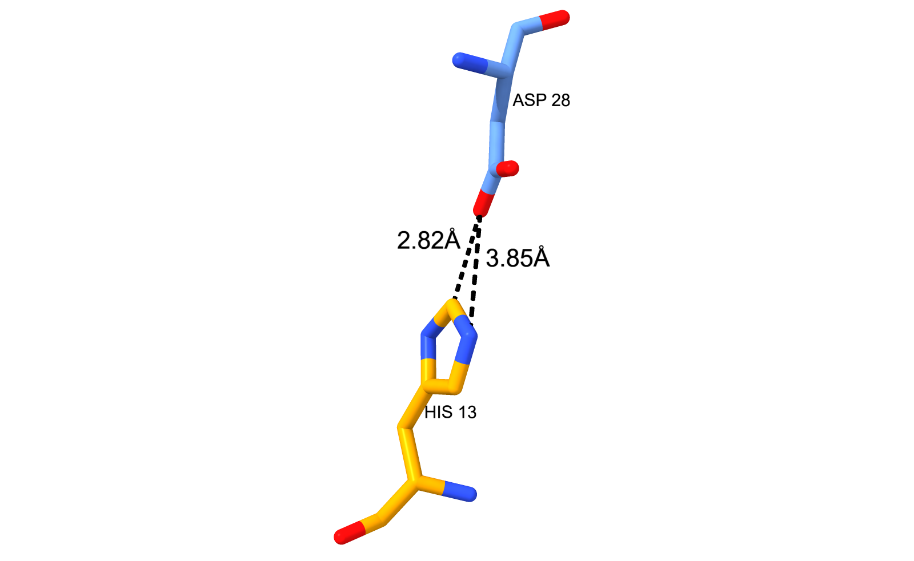

# Relatório: R337H-TP53 e o AlphaFold 3

> Os resultados abaixo derivam de previsões do AlphaFold 3 e estão sujeitos aos [AlphaFold 3 Output Terms of Use](https://github.com/google-deepmind/alphafold3/blob/main/OUTPUT_TERMS_OF_USE.md) (uso não comercial). Citação: Abramson et al. (2024), *Nature*, https://doi.org/10.1038/s41586-024-07487-w. Estudo teórico e exploratório, sem validade clínica.

## 1. Resumo

Comparei tetrâmeros previstos pelo AlphaFold 3 para o domínio de tetramerização da p53 (resíduos 325–356) na forma selvagem (WT) e na variante R337H, usando 5 seeds por sistema (25 modelos cada) e a estrutura 1C26 como referência. O AF3 recuperou a arquitetura do cristal (RMSD de Cα mediano 1,26 Å no WT e 1,16 Å no R337H). WT e R337H foram globalmente muito parecidos (0,95 Å), dentro da ordem de grandeza da variação interna de cada sistema. A diferença consistente foi local: no WT, o resíduo 337 faz contato com o Asp352 da subunidade vizinha por um nitrogênio da guanidina (N···O 2,52–3,00 Å em todos os modelos); no R337H a distância N···O é maior e mais variável (2,62–3,93 Å) e, na maioria das subunidades, o átomo mais próximo do Asp352 é um carbono do anel da histidina (CE1). Isso é compatível com a literatura sobre a interação 337–352, mas **não demonstra** instabilidade, dependência de pH nem efeito funcional.

## 2. Métodos

**Sequências.** UniProt P04637, resíduos 325–356, extraídos e validados por código (posição 337 = R, 352 = D; mutante difere só em 337). Nos arquivos do AF3 a numeração é 1–32 (337 → 13; 352 → 28).

**Previsões.** AlphaFold Server, uma entidade proteica com 4 cópias, seeds 333, 1, 2, 3 e 4, para WT e R337H (5 modelos por job). O servidor usou `useStructureTemplate: true` (padrão); os templates não foram inspecionados. A correspondência entre pasta e seed foi verificada com `scripts/check_seeds.py`.

**Referência.** Montagem biológica do PDB 1C26 (4 cadeias de 32 resíduos).

**Controle de qualidade.** Número de cadeias, sequência, resíduo na posição 337, clashes e métricas de confiança (pTM, ipTM, pLDDT) para os 50 modelos.

**RMSD.** Cα das 4 cadeias (128 átomos), superposição por mínimos quadrados (Kabsch) testando as 24 permutações de cadeias e mantendo a de menor RMSD. A linha de base é a variação entre modelos do mesmo sistema (mesma seed e seeds diferentes).

**Contatos.** Pares de resíduos de cadeias diferentes com distância mínima entre átomos pesados < 5 Å (principal) e < 4 Å (sensibilidade). Os cortes foram definidos antes da análise. As cadeias de cada modelo foram reordenadas para a ordem do 1C26.

**Interação 337–352.** Para cada subunidade, a cadeia parceira é a que tem o Asp352 com o átomo polar mais próximo. Medidas: distância N···O (N de Arg/His337 e O do Asp352) e menor distância entre cadeias laterais. Também identifiquei os átomos do par mais próximo.

**Unidade de análise.** O modelo (média das 4 subunidades). A comparação com o máximo do WT e a contagem de modelos "longos" foram **definidas depois de ver os dados** e são descritivas.

## 3. Resultados

### 3.1 Controle de qualidade
Todos os 50 modelos: 4 cadeias, sequência correta, ARG (WT) ou HIS (R337H) na posição 337, sem clashes. ipTM: WT 0,82–0,85; R337H 0,86–0,89 (pTM: 0,84–0,87 e 0,87–0,90). pLDDT no resíduo 352: cerca de 90–93 (WT) e 93–95 (R337H). São medidas de confiança do modelo, não de estabilidade.

### 3.2 Arquitetura global (RMSD de Cα, Å)

| Comparação | n | Mediana | Mín–Máx |
|---|---|---|---|
| WT vs 1C26 | 25 | 1,264 | 0,530–1,807 |
| R337H vs 1C26 | 25 | 1,160 | 0,746–2,299 |
| WT vs R337H | 625 | 0,950 | 0,368–2,088 |
| WT vs WT (mesma seed) | 50 | 0,704 | 0,214–1,595 |
| WT vs WT (seeds diferentes) | 250 | 0,853 | 0,171–1,560 |
| R337H vs R337H (mesma seed) | 50 | 0,832 | 0,153–2,145 |
| R337H vs R337H (seeds diferentes) | 250 | 0,838 | 0,152–2,115 |

A diferença WT–R337H é pequena e as faixas se sobrepõem às das linhas de base. Alguns modelos chegam a 2,1–2,3 Å; não investiguei se isso vem dos terminais flexíveis.

### 3.3 Contatos entre cadeias
Mediana de pares de resíduos em contato (5 Å): 1C26 206; WT 209; R337H 208 (4 Å: 136, 138, 142). Contatos presentes em todos os 25 modelos: 176 no WT e 163 no R337H; os 176 do WT estão todos no 1C26. Oito contatos (337 com 345 e 349, interfaces A-C e B-D) estão em todos os WT e em nenhum R337H; nenhum contato é exclusivo do R337H. Como a Arg tem cadeia lateral mais longa que a His, parte dessa diferença pode refletir só o tamanho do resíduo. A menor interface (A-B/C-D) tem mediana de 10 contatos no R337H, 6 no WT e 4 no 1C26; tratada como observação.

### 3.4 Interação 337–352

| | WT | R337H |
|---|---|---|
| N···O por modelo, mediana (mín–máx) | 2,75 (2,52–3,00) Å | 3,50 (2,62–3,93) Å |
| Cristal 1C26 | 2,72 Å | – |

No R337H, 9 modelos ficam entre 2,62 e 3,00 Å, 1 em 3,19 Å e 15 entre 3,49 e 3,93 Å; 16 de 25 estão acima de 3,1 Å, nenhum modelo WT passa de 3,00 Å. Os modelos "longos" (≥ 3,49 Å) aparecem nas 5 seeds (3, 2, 3, 4 e 3 modelos nas seeds 1, 2, 3, 4 e 333). A distribuição tem dois grupos com alguns modelos intermediários.

### 3.5 Átomo mais próximo do Asp352 (100 subunidades por sistema)

| Sistema | Par | n | Distância mediana (Å) |
|---|---|---|---|
| WT | NH1···OD2 | 75 | 2,75 |
| WT | NH2···OD2 | 21 | 2,83 |
| WT | NH2···OD1 | 4 | 2,74 |
| R337H | CE1···OD2 | 60 | 2,79 |
| R337H | NE2···OD2 | 40 | 2,81 |

### 3.6 Figuras ilustrativas
Três modelos da seed 2 (WT modelo 2; R337H modelos 2 e 3), cadeias A e B dos arquivos do AF3: WT NH1···OD2 2,72 Å e NH2···OD2 3,23 Å; R337H modelo 2 NE2···OD2 2,80 Å e CE1···OD2 3,99 Å; R337H modelo 3 CE1···OD2 2,82 Å e NE2···OD2 3,85 Å. A escolha seguiu um critério declarado antes da inspeção visual (WT próximo da mediana; um R337H de cada tipo), mas já com conhecimento dos números; são exemplos, e a evidência são os 50 modelos.

*Laranja: Arg/His337; azul: Asp352. Tracejado: distâncias em Å (o valor menor é NH1, NE2 e CE1 nas figuras WT, curta e longa).*

## 4. Discussão

Os resultados apoiam, de forma exploratória, as hipóteses H1 (o AF3 reproduz a organização do 1C26), H2 (sem mudança global drástica) e H3 (diferença localizada). Os dois arranjos do R337H sugerem que a interface em torno do 337 é menos regular nas previsões da variante, o que é compatível com a perda da interação Arg337–Asp352 descrita na literatura (DiGiammarino et al., 2002). Isso é uma hipótese estrutural, não uma confirmação do mecanismo. O ipTM maior no R337H não deve ser lido como maior estabilidade.

## 5. Limitações

1. **Sem pH nem protonação.** O AF3 não informa o estado de protonação da His337. NE2 vs CE1 pode ser apenas orientação do anel (flip), e uma distância C···O curta não prova interação favorável.
2. **Geometria estática.** Distâncias e contatos não medem energia livre de associação, dissociação nem estabilidade.
3. **Não independência.** Os 5 modelos de uma seed vêm do mesmo job, e as 4 subunidades de um modelo são quase iguais por simetria. Não foram aplicados testes estatísticos.
4. **Referência não cega.** O 1C26 é de 1999, anterior ao treino do AF3, e o servidor usa templates por padrão (não inspecionados). A concordância com o 1C26 é consistência, não generalização.
5. **Domínio isolado e homotetrâmero.** Não foram modelados tetrâmeros mistos (heterozigotos) nem a proteína completa.
6. **Análises post hoc.** O limiar de 3,1 Å e a contagem de modelos "longos" foram escolhidos depois de ver os dados. Um corte de 3,5 Å que usei inicialmente foi descartado por ter vários modelos na fronteira (3,49–3,52 Å).
7. **Sem validação clínica.** O estudo não classifica a variante nem estima risco.

## 6. Registro de desvios

- O job `p53_R337H_325_356_x4_seed1` foi enviado por engano com a seed 2 (detectado em `modelSeeds`). A pasta `R337H/seed_1` foi substituída pelo job `p53_R337H_325_356_x4_seed1_v2` (seed 1) e a análise inteira foi refeita. Desde então `scripts/check_seeds.py` valida as pastas.
- A letra da cadeia parceira do Asp352 nos arquivos do AF3 difere da ordem do 1C26; nas figuras, a parceira de A é B nos três modelos usados, verificada por medição.

## 7. Extensões possíveis

Tetrâmeros mistos WT/R337H; análise de protonação e pH (química computacional ou dinâmica molecular); RMSD sem os terminais; mais seeds; inspeção dos templates usados pelo servidor.

## Referências

1. Abramson et al. (2024), *Nature*. https://doi.org/10.1038/s41586-024-07487-w
2. DiGiammarino et al. (2002), *Nat. Struct. Biol.* https://doi.org/10.1038/nsb730
3. PDB 1C26: https://www.rcsb.org/structure/1C26
4. UniProt P04637: https://www.uniprot.org/uniprotkb/P04637/entry
